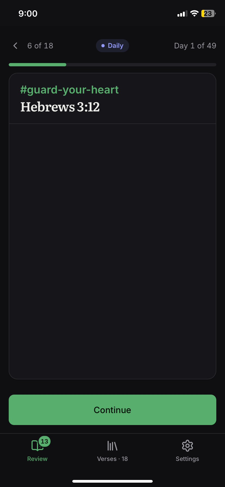
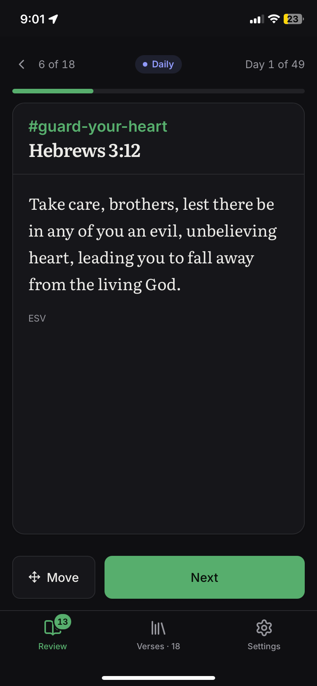
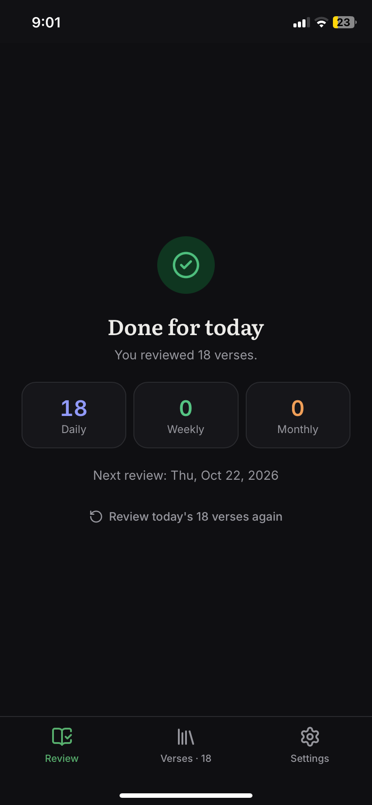
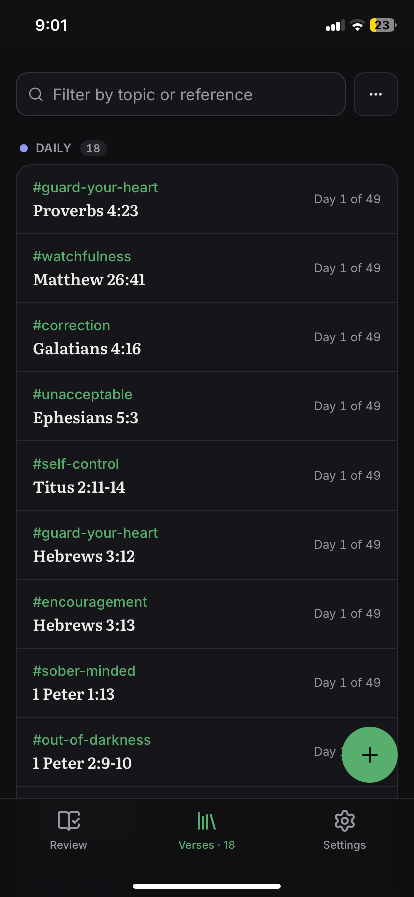

# Scripture Retention

Keep the Scripture you've already memorized: review each verse daily, then weekly, then monthly.

**[Open the app → mastertemple.github.io/scripture-retention](https://mastertemple.github.io/scripture-retention/)**

<p align="center">
  <a href="docs/review-card.png"></a>
  <a href="docs/review-verse.png"></a>
  <a href="docs/done.png"></a>
  <a href="docs/verses.png"></a>
</p>
<p align="center"><sub>Say it aloud · Check the verse · Done for today · Your verses</sub></p>

## The method

It follows the *Scripture Memorization and Meditation System* Tom Frost uses at the [Foundation for Reasonable Christianity](https://www.reasonablechristianity.org/). Each verse is said aloud (its topic, its reference, then the verse):

| Phase | How often | For how long |
| --- | --- | --- |
| Daily | Every day | 7 weeks |
| Weekly | Every week | 7 months |
| Monthly | Every month | 7 years |

> [!NOTE]
> This is not performed in order to memorize a verse, but to retain a verse you have already memorized, and to foster meditation on it.

It is designed that you would add 1 verse each week. Doing it at this rate will result in reciting 23 verses each day, but that is after you have completely filled the moving window of daily, weekly, and monthly verses (which takes 7 years to build up to). At that point, it will be a very manageable 5-10 minute activity each day.

You are free to add as many verses as you would like per week, however it is encouraged that you prioritize maintaining and reviewing previous verses, rather than memorizing more and more, lest you forget what you have worked towards.

## Scheduling algorithms

The method above is the default. Settings → **Schedule** can switch to any of the major spaced-repetition algorithms, which grade each review and space the next by how well the verse came back:

| Algorithm | Grades | How it schedules |
| --- | --- | --- |
| **Scripture Memory** (default) | Next | Daily, weekly, then monthly, for set lengths of time |
| **FSRS** | Again, Hard, Good, Easy | Anki's modern scheduler: each verse's stability and difficulty, and a review when recall falls to your desired retention. FSRS-4.5, FSRS-5, and FSRS-6, chosen by the parameters given (paste Anki's own) |
| **Anki (SM-2)** | Again, Hard, Good, Easy | Anki's classic scheduler: learning and relearning steps, ease, easy bonus, hard interval, interval modifier, new interval, fuzz, and leeches, as in Anki's deck options |
| **SuperMemo SM-2** | Again, Hard, Good, Easy (qualities 2–5) | 1 day, 6 days, then times the E-Factor; below Good, drilled again the same day |
| **Leitner boxes** | Again, Good | A box per interval (1, 2, 4, 8… days); recalled moves up, forgotten goes back |
| **Pimsleur** | Again, Good | Graduated intervals about five times apart: 1, 5, 25, 120, 730 days |
| **Ebisu** | Again, Good | A Bayesian estimate of each verse's half-life; due when recall falls to your target |

Under any of them:

- Each button shows when the verse would come back (`<10m`, `3d`, `2mo`). A step under a day (Anki's `1m 10m`) brings the verse back later in the same sitting.
- Every review is kept, and an algorithm's view of a verse comes from all of them, so you can switch algorithms at any time and nothing is lost. A verse from before grading (or imported at `@week 3`) starts where the fixed schedule has it.
- Phases are named by how far apart the reviews are: *Days*, *Weeks*, *Months*.
- Tap a verse in **Verses** to see what the algorithm knows of it (stability, difficulty, ease, box, half-life, retrievability), its history, and to reschedule it or start it over as new.

**Optimize** (Settings → Schedule → FSRS) fits FSRS's parameters to how you've graded your verses, with [fsrs-rs](https://github.com/open-spaced-repetition/fsrs-rs), the optimizer Anki runs, on your device. It learns from verses graded since they were new, so verses from before grading count once they're started over; it needs a few hundred reviews to beat the defaults.

Not included: SuperMemo's later algorithms (SM-17/18, unpublished in full), and Duolingo's half-life regression, whose weights have to be trained on a large body of reviews (noted in `docs/srs-algorithms-plan.md` for later).

## Books and chapters

Memorized a whole book, or chapters? **Verses → ⋯ → Add a book or chapters** adds it as one passage, typed (`1 Peter`, `Romans 8-12`, `Psalm 119:1-16`) or picked (a book, then the chapters). Choose how it's split into cards:

| Cards | 1 Peter becomes |
| --- | --- |
| Verses | 105 cards, `1 Peter 1:1` … |
| Chapters | 5 cards, `1 Peter 1` … `1 Peter 5` |
| Groups of N verses | `1 Peter 1:1-5`, `1 Peter 1:6-10` … (within each chapter) |
| One card | `1 Peter` |

Each card is reviewed on its own schedule, and the passage is one row in **Verses** (how many cards, how many due), added and deleted as a whole.

## Decks

Keep verses in decks, such as topical verses in one and a book you're memorizing in another. **Verses** shows one deck or all of them, and **Review** reviews one deck or all. A deck follows the default schedule, or has its own algorithm and options (Settings → Schedule → *Schedule for*), so topical verses can stay on the method above while a book follows FSRS. Deleting a deck deletes what's in it (with undo).

## Install it

It's a web app that installs like any other and works offline.

- **iPhone or iPad:** open [the site](https://mastertemple.github.io/scripture-retention/) in Safari, tap **Share**, then **Add to Home Screen**.
- **Android, or Chrome and Edge on a computer:** choose **Install app** in the browser's menu.

## Reviewing

**Review** shows one card at a time: the topic (`#guard-your-heart`) and the reference.

1. Say the topic, the reference, and the verse.
2. Tap the card (or swipe it, or tap **Continue**) to see the verse.
3. Tap **Next** to go on, or swipe right to go back. Under an adaptive algorithm, tap how well it came back: **Again**, **Hard**, **Good**, or **Easy**.

**Move** puts a verse in another phase, and how far into it ("week 3 of the weekly reviews"); a moved verse counts as reviewed.

A verse is due on its scheduled day (every day, then every 7 days, then the same day each month) and stays due until it's reviewed, so a missed weekly or monthly verse comes up the next day.

On a computer:

| Key | Does |
| --- | --- |
| Space, Enter, or → | Continue, then Next (Good) |
| 1, 2, 3, 4 | Again, Hard, Good, Easy (in the buttons' order) |
| ← | Back |
| M | Move (or reschedule) |

## Your verses

**Verses** lists every verse by where it is: daily, weekly, monthly, queued, upcoming, or retained. Tap one to change its topic, reference, or place in the schedule, or to delete it. Where a verse is follows from one date alone: the day its daily reviews began.

As you type a reference, the app suggests completions and shows a verse's text, so you can see it's the one you meant.

### The queue

Queue verses to start later, so they don't need entering on the day: **Add a verse**, then *Queue it* (or **+ Queue a verse** in the list).

- One starts each week, on the day chosen in Settings (Monday unless changed), in a week no verse has started yet.
- Reorder them with the arrows, or switch to *By hand* and start each one yourself.
- A day the app wasn't opened on still starts its verse, dated that day.
- A verse can also be given a start date ahead, which puts it under *Upcoming*.

### Importing and exporting

**Import** adds a whole list at once, one verse a line:

```
Daily:
`#before-my-eyes` Psalm 101:3
`#in-the-night` Psalms 119:55 @day 12

Weekly:
`#guard-your-heart` Proverbs 4:23
`#assurance` 1 John 5:13 @week 3
`#desire` Proverbs 6:25 @2026-01-04

Monthly:
`#called` Romans 8:28 @month 5

Queue:
`#renewed` Romans 12:1-2
```

- A heading (`Daily:`, `Weekly:`, `Monthly:`, or `## Daily` and so on) puts the verses below it in that phase, at its first review today.
- `@day 12`, `@week 3`, or `@month 5` places a verse further in; `@2026-01-04` gives the day its daily reviews began.
- Verses under `Queue:` are queued.
- The topic and backticks are optional; `#?` is a verse without a topic yet.
- `1 Peter as chapters`, `Romans 8 as verses`, `Psalm 119 as groups of 8`, or `James as one card` adds a passage as one.
- A `Deck: Name` line puts what's below it in that deck, adding the deck if it isn't there yet.

**Copy all as a list** (or **Share**, or **Save as a file**) exports every verse in the same form, with start dates, so it imports back the same.

A list keeps where each verse is, not its graded reviews. Settings → Data → **Save backup** keeps everything (every review, the queue, and your settings) in one file, which **Restore** reads back.

> [!IMPORTANT]
> Your verses are kept in this browser only, so save a copy now and then.

## Bibles

The verse's text shows in the translation chosen in Settings:

- **Built in:** BSB, KJV, WEB, ASV, LSV, and YLT, from [fetch.bible](https://fetch.bible).
- **Browse more:** any of fetch.bible's ~1,400 translations.
- **Upload your own:** a `.zip` of a whole Bible in USFM or USX (for example eBible.org's `*_usfm.zip`), an OSIS file, or single `.usfm`, `.sfm`, or `.usx` book files. Files are read on your device and never uploaded anywhere.

Each book downloads the first time it's needed and stays on the device, so reviewing works offline.

## Reminders

Settings → **Reminders** has two, each at a time you choose:

- **Review each day**, on days with verses due.
- **Add a new verse**, one day a week, when nothing is queued or dated ahead to start next.

The site has no server, so it can't push a notification at an exact time the way a native app can. How reminders arrive depends on the device:

| Where | How |
| --- | --- |
| Installed in Chrome or Edge (Android, computer) | The browser wakes the app now and then, and it shows any reminder whose time has passed, sometimes a little late |
| Open in the background | On time, in any browser that shows notifications |
| iPhone and iPad | Only with the app on the Home Screen, and Safari doesn't wake a closed app |
| **Add to my calendar** | Repeating calendar events that open the app, on time on every phone: the sure way |

`scriptable/scripture-review.js` is a [Scriptable](https://scriptable.app) script for an iPhone that schedules a daily notification opening the review.

## Settings

| Tab | What's in it |
| --- | --- |
| Review | Order (by phase or shuffled), keep the card steady, show the prompt, text size, the hour a new day begins, review today again |
| Schedule | The algorithm and its options (the default schedule, or a deck's own), optimizing FSRS, how long each phase lasts, and the day queued verses start |
| Reminders | Review each day, add a new verse, add to my calendar |
| Bible | The translation: built in, from fetch.bible, or uploaded |
| Appearance | The title bar, the theme, and the accent color (one of ten, or any color, kept readable in both themes) |
| Data | Import, copy, share, or save your verses; save or restore a backup; check for updates; the source code on GitHub; links |

### Links

For a bookmark or a home-screen shortcut (Settings → Data has each ready to copy):

- [Today's review](https://mastertemple.github.io/scripture-retention/)
- [Your verses](https://mastertemple.github.io/scripture-retention/?view=verses): `?view=verses`
- [Import](https://mastertemple.github.io/scripture-retention/?view=import): `?view=import`

## Development

```bash
npm install
npm run dev        # http://localhost:5173
npm test           # unit tests (the schedule, every algorithm, lists, queue, reminders, parsing, verse text)
npm run build      # static site in dist/
```

- React 19, TypeScript, Vite, Tailwind CSS v4, and Radix primitives (shadcn-style components in `src/components/ui`)
- `src/core/` (dates, the schedule, lists, the queue, reminders) has no browser imports, so the service worker uses it too
- `src/core/srs/` holds the algorithms, each a set of pure functions over a verse's review log; FSRS is tested against [ts-fsrs](https://github.com/open-spaced-repetition/ts-fsrs) 3, 4, and 5 (FSRS-4.5, 5, and 6)
- `src/core/decks.ts` and `src/core/passages.ts`: each deck's schedule, and splitting a passage into cards (every card reads back, through topos, as exactly its verses)
- FSRS's optimizer is the Rust engine's WebAssembly (`rust/`), vendored in `vendor/scripture-srs` and loaded in a worker only when optimizing; `scripts/vendor-srs.sh` rebuilds it
- [topos-bible](https://www.npmjs.com/package/topos-bible) reads references and completes them as they're typed (`src/bible/topos.ts`)
- [logoxide](https://www.npmjs.com/package/logoxide) reads USFM, USX, OSIS, and zips into per-verse text in a Web Worker, so its WebAssembly only loads when a book is first needed (`src/bible/parse.ts`, `src/bible/worker.ts`)
- zustand for state (verses and settings persist in localStorage)
- [vite-plugin-pwa](https://vite-pwa-org.netlify.app) builds the service worker (`src/sw.ts`), which caches the app for offline use and shows reminders from a copy of the state in IndexedDB (`src/lib/reminders.ts`)

### Rust

[`rust/`](rust) has the same scheduling engine as a Rust library (checked against this app's case by case), bindings for TypeScript and Python made with BoltFFI, and a terminal app (Ratatui) that reviews from the same backup file:

```bash
cd rust && cargo run --release -p scripture-tui -- --file scripture-retention-backup.json
```

The build is a static site with no server or API keys, and its URLs are relative, so it can be hosted under any path. Each push to `main` tests, builds, and deploys it to [GitHub Pages](https://mastertemple.github.io/scripture-retention/) (`.github/workflows/deploy.yml`, with Pages set to deploy from *GitHub Actions* in the repository's settings).
